# 3Point: Kapsamlı Proje Yol Haritası (Master Roadmap)

> **Vizyon:** 3Point; 3D poligon modelleme, dijital heykeltraşlık, karakter armatür/animasyonu ve gerçek zamanlı oyun motoru runtime'ını tek bir çatı altında birleştiren, **%100 saf Rust** ile sıfırdan yazılmış, modern, modüler ve yüksek performanslı yeni nesil bir dijital içerik üretim (DCC) ve oyun geliştirme stüdyosudur.
>
> **Hedef Donanım Profili:**
> * **🌱 Düşük Donanım & Hafiflik (Öncelikli):** Eski nesil Intel HD/UHD, AMD Vega/RDNA entegre GPU'lar ve giriş seviyesi dizüstü bilgisayarlarda sıfır gecikmeli 60 FPS akıcı çalışma. Ağır harici SDK'lara ve C++ çalışma ortamlarına gerek duymayan bağımsız tek dosya (`.exe`).
> * **⚡ Yüksek Donanım & Üretim Kalitesi:** Modern ayrık GPU'larda (NVIDIA RTX, AMD RX) sıfır kopyalı Vulkan iş hatları, SIMD hızlandırmalı matematik, çok çekirdekli iş parçacığı havuzu ve ölçeklenebilir PBR render kalitesi.

---

## 🏛️ Mimari Çalışma Alanı (Workspace Architecture)

Proje, bağımsız derlenebilir ve %100 test kapsamına sahip 8 alt modülden (crates) oluşur:

```text
3point/
├── Cargo.toml                  # Workspace manifest ve LTO dağıtım profili
├── release/                    # Dağıtıma hazır bağımsız ikili dosyalar (Beta v1.2)
├── crates/
│   ├── tp_math/                # SIMD destekli lineer cebir, Frustum, Ray, AABB ve dönüşüm hiyerarşisi
│   ├── tp_core/                # Asenkron görev havuzu, halka tamponlar, zamanlayıcı ve telemetri
│   ├── tp_gfx/                 # Vulkan 1.2 (ash) HAL katmanı, RenderGraph, Infinite Grid, Debug Draw
│   ├── tp_mesh/                # Half-Edge DCEL topolojisi, modelleme operatörleri, BVH ray-pick, .OBJ ve .3P IO
│   ├── tp_anim/                # İskelet armatürleri, FK/IK (Two-Bone, FABRIK), LBS/DQS skinning, Timeline
│   ├── tp_scene/               # ECS sahne grafiği (hecs), yaşam döngüsü (Edit/Play/Pause), şablonlar
│   ├── tp_physics/             # Rapier3D dinamik/statik katı cisimler ve çarpışma motoru
│   ├── tp_ui/                  # Vulkan doğrudan egui entegrasyonu, stüdyo modları, 3B gizmolari
│   └── tp_app/                 # Ana masaüstü uygulaması, girdi döngüsü ve motor koordinasyonu
```

---

## 🗺️ Faz İlerleme Şeması

```mermaid
flowchart TD
    subgraph COMPLETED ["✅ TAMAMLANAN FAZLAR (Beta v1.0 - v1.2)"]
        F0["Faz 0: Temel Altyapı & Matematik"] --> F1["Faz 1: Vulkan 1.2 Render Motoru"]
        F1 --> F2["Faz 2: Half-Edge 3D Modelleme"]
        F1 --> F3["Faz 3: UI & Stüdyo Editörü"]
        F2 --> F3
        F1 --> F4["Faz 4: Karakter & İskelet Animasyonu"]
        F3 --> F5["Faz 5: ECS & Oyun Motoru Runtime"]
        F4 --> F5
        F5 --> F6["Faz 6: MVP Sürümü, Optimizasyon & Beta v1.2"]
    end

    subgraph UPCOMING ["🚀 YENİ YOL HARİTASI (v0.2 -> v1.0 Production)"]
        F6 ==> F7["Faz 7: PBR Materyaller, Doku & Dinamik Gölgeler"]
        F7 ==> F8["Faz 8: İleri Seviye Modelleme, UV & Heykeltraşlık"]
        F8 ==> F9["Faz 9: Varlık Tarayıcısı, Prefab & GLTF 2.0"]
        F9 ==> F10["Faz 10: Oyun Komut Dosyası (Scripting) & 3D Ses"]
        F10 ==> F11["Faz 11: Karakter Rigging & Animasyon Durum Makinesi"]
        F11 ==> F12["Faz 12: Bağımsız Oyun İhracı (Export) & 1.0 Kararlı Sürüm"]
    end

    style COMPLETED fill:#1a2e1a,stroke:#4caf50,stroke-width:2px;
    style UPCOMING fill:#1a243b,stroke:#2196f3,stroke-width:2px;
```



---

## ✅ Tamamlanan Fazlar ve MVP Sürümü (Beta v1.0 - v1.2)

### [x] Faz 0: Temel Altyapı ve Sistem Çekirdeği (`tp_math`, `tp_core`)
- [x] Modüler Cargo workspace mimarisi ve bağımlılık optimizasyonu.
- [x] SIMD destekli vektör, matris ve kuaterniyon matematiği (`glam`).
- [x] Transform hiyerarşisi (Yerel ve Dünya matrisleri).
- [x] Geometrik hacim testleri: Ray, AABB, 6-düzlemli analitik Frustum.
- [x] Asenkron loglama ve teşhis sistemi (`tracing`, `tracing-subscriber`).
- [x] Yüksek frekanslı delta-zaman hesaplayıcı (`Time`) ve görev havuzu (`TaskPool`).
- [x] `winit 0.30` DPI duyarlı çoklu platform pencere oluşturma ve olay döngüsü.

### [x] Faz 1: Vulkan Grafik Donanım Katmanı (`tp_gfx`)
- [x] Saf Vulkan 1.2 (`ash`) donanım katmanı, doğrulama katmanları (`VK_LAYER_KHRONOS_validation`).
- [x] Çoklu GPU değerlendirme ve akıllı seçim (Ayrık GPU önceliği + Entegre GPU tam desteği).
- [x] Dinamik Swapchain, sRGB renk uzayı, V-Sync sunum modu ve otomatik `recreate_swapchain`.
- [x] CPU-GPU senkronizasyonu için 2 Frames-in-Flight semafor ve fence döngüsü.
- [x] Vulkan RenderPass ve Framebuffer boru hattı.
- [x] Donanım hızlandırmalı sonsuz zemin ızgarası (Infinite Grid) ve tel kafes (Debug Draw) hattı.
- [x] MatCap ve temel yönlü Blinn-Phong aydınlatma gölgelendiricileri.

### [x] Faz 2: 3D Poligon Modelleme Katmanı (`tp_mesh`)
- [x] Manifold Half-Edge (DCEL) topolojik veri yapısı: `Vertex`, `HalfEdge`, `Edge`, `Face`.
- [x] Çift yönlü üçgenleştirici (`to_tri_mesh`) ve manifold doğrulama testleri.
- [x] Parametrik temel geometriler: Küp, UV Küresi, Silindir, Düzlem.
- [x] Etkileşimli modelleme operatörleri:
  - **Extrude:** Yüzey ve kenar ekstrüzyonu.
  - **Inset:** Yüzey içi poligon yerleştirme.
  - **Subdivide:** Catmull-Clark yüzey alt bölümleme ve yumuşatma.
- [x] Komut desenli bellek dostu Geri Al / Yinele yığını (`UndoStack`, `SnapshotMeshCommand`).
- [x] BVH (Bounding Volume Hierarchy) hızlandırmalı $O(\log N)$ hassas fare ışın atımıyla yüzey seçimi (Ray-Picking).

### [x] Faz 3: UI/UX & Stüdyo Editör Katmanı (`tp_ui`)
- [x] Vulkan RenderPass içi doğrudan `egui` GPU çizim hattı (`EguiVulkanRenderer`).
- [x] Özel karanlık stüdyo teması (Blender 4.x / Unreal 5 yüksek kontrast estetiği).
- [x] Viewport kamera navigasyonu (Sağ tık ile Orbit, Orta tık ile Pan, Tekerlek ile Zoom).
- [x] Viewport ve egui giriş tüketim ayrımı (`is_consumed_by_ui`).
- [x] Stüdyo panelleri: Üst Menü, Sol Araç Çubuğu, Outliner (Sahne Hiyerarşisi), Inspector (Özellik Paneli).

### [x] Faz 4: Karakter & Nesne Animasyon Sistemi (`tp_anim`)
- [x] Hiyerarşik kemik iskeleti (`Skeleton`, `Bone`) ve $O(N)$ Forward Kinematics (FK).
- [x] Bind Pose ve GPU ters bağlama matrisleri ($M_{skin} = M_{world} \cdot M_{bind}^{-1}$).
- [x] Köşe başına 4 kemik ağırlıklı Linear Blend Skinning (LBS) ve Dual Quaternion Skinning (DQS).
- [x] Zaman çizelgesi eğri örneklemesi: Step, Linear (Slerp), Hermite Cubic Spline.
- [x] Ters Kinematik çözücüleri: Analitik Two-Bone IK ($O(1)$) ve çok eklemli omurga FABRIK IK.
- [x] Animasyon oynatıcı, klip harmanlama (Linear Blending) ve çapraz geçiş (Cross-Fade).
- [x] Editör alt kısmında etkileşimli Animasyon Zaman Çizelgesi (Timeline & Dopesheet).

### [x] Faz 5: Oyun Motoru Runtime & ECS (`tp_scene`, `tp_physics`)
- [x] Hafif arketip tabanlı ECS mimarisi (`hecs`).
- [x] Temel ECS bileşenleri (`TransformComponent`, `MeshRenderer`, `CameraComponent`, `LightComponent`, vb.).
- [x] Rapier3D 3D fizik motoru entegrasyonu: Dinamik/Statik gövdeler, Kutu/Küre/Silindir çarpıştırıcılar, yerçekimi, sürtünme.
- [x] Canlı çalışma durumları: `Edit`, `Play`, `Pause`.
- [x] Sahne Snapshot & Restore mekanizması (Play modu durdurulduğunda sahnenin düzenleme anına hatasız dönmesi).

### [x] Faz 6: Optimizasyon, Telemetri & Beta v1.2 Dağıtımı
- [x] Analitik 6-düzlemli Frustum Culling ile kamera dışındaki nesneleri GPU çiziminden eleme.
- [x] Wavefront OBJ içe/dışa aktarımı (`export_obj`, `import_obj`).
- [x] Sıfır kopyalı yerel ikili format (`.3p`, `export_3p`, `import_3p`).
- [x] Hazır şablon sahneleri: Boş Stüdyo, Karakter Stüdyosu, Fizik Kum Havuzu.
- [x] Canlı telemetri paneli (FPS, ms, Frustum culling durumu, düşük donanım tasarruf modu).
- [x] **Beta v1.2 Yenilikleri:**
  - Viewport üzerinde etkileşimli 3B Taşıma, Döndürme, Ölçekleme gizmolari ve kısayollar (`G`, `R`, `S`, `Esc`).
  - Perspektif Kamera (piramit frustum) ve Yönlü Işık (güneş diski + ışınlar) 3B görsel simgeleri.
  - Çoklu nesne kalıcılığı: Yeni nesne eklendiğinde öncekiler silinmez; bağımsız renkler, dönüşümler ve GPU tamponları.
  - Dinamik Stüdyo Modu geçişleri: Modelleme, Animasyon, Sahne, Oyun modlarına özel dinamik panel düzeni.
  - Windows x64 bağımsız LTO optimize dağıtım ikilisi (`release/3point-beta-v1.2.exe`).

---

## 🚀 Yeni Yol Haritası (Post-MVP & Version 1.0 Production)

```
┌─────────────────────────────────────────────────────────────────────────────┐
│                             YOL HARİTASI PLANI                              │
├─────────────────┬───────────────────────────────────┬───────────────────────┤
│ Sürüm Hedefi    │ Kapsanan Fazlar                   │ Odak Alanı            │
├─────────────────┼───────────────────────────────────┼───────────────────────┤
│ v0.3            │ Faz 7: Materyal & Render          │ PBR, Dokular, Gölgeler│
│ v0.4            │ Faz 8: İleri Modelleme & Sculpt   │ Bevel, Knife, UV, CSG │
│ v0.5            │ Faz 9: Varlık Yönetimi & Prefab   │ Content Drawer, GLTF  │
│ v0.6            │ Faz 10: Oyun Mantığı & Ses        │ Scripting, Nodes, Audio│
│ v0.7            │ Faz 11: Karakter Rigging & States │ Weight Paint, States  │
│ v1.0 (Final)    │ Faz 12: Çoklu Platform & Yayın    │ Standalone Export     │
└─────────────────┴───────────────────────────────────┴───────────────────────┘
```

---

### 🎨 Faz 7: Materyal Sistemi, Doku Yönetimi ve İleri Seviye PBR Render Hattı
*Hedef: Stüdyo kalitesinde gerçekçi fiziksel tabanlı aydınlatma (PBR), çok kanallı doku eşleme ve dinamik gölgeler.*

- [ ] **PBR Metallic-Roughness Materyal Mimarisi:**
  - Standart Cook-Torrance mikro-yüzey yansıma modeli (GGX dağılımı, Smith geometrik gölgeleme, Schlick Fresnel).
  - Materyal Kanalları: `Albedo (Base Color)`, `Metallic`, `Roughness`, `Normal Map (Teğet Uzayı)`, `Ambient Occlusion (AO)`, `Emissive`.
  - Materyal Varlık Tanımı (`.3pmaterial` JSON/ikili formatı) ve nesnelere bağımsız materyal atama.
- [ ] **GPU Doku Yükleyici & Önbelleği (`tp_gfx::texture`):**
  - PNG, JPEG, TGA ve HDR formatları için sıfır kopyalı GPU doku transferi (`image` crate entegrasyonu).
  - Otomatik GPU Mipmap üretimi (vkCmdBlitImage zinciri) ile uzaktaki dokularda kırılmayı (aliasing) engelleme.
  - Tekrarlanan dokular için küresel GPU Doku Yöneticisi ve doku atlası önbelleği.
- [ ] **Dinamik Gölgeler (Directional Shadow Mapping):**
  - Yönlü güneş ışığı için Cascaded Shadow Mapping (CSM - 3-4 kaskat seviyesi).
  - Gölge haritası derinlik tamponu (Depth RenderPass, 2048x2048).
  - PCF (Percentage Closer Filtering) 4x4 donanım filtrelemesi ile yumuşak gölge kenarları.
- [ ] **Ortam Aydınlatması ve HDR Skybox (Image-Based Lighting - IBL):**
  - 360° HDR gökyüzü dokusu yükleyici ve Viewport arkaplan küresi (Skybox).
  - Diffuse Irradiance ve Split-Sum Specular ön hesaplama gölgelendiricileri.
- [ ] **Post-Processing Efekt Zinciri (Görsel Zenginleştirme):**
  - ACES (Academy Color Encoding System) filmik ton eşleme (Tone Mapping).
  - Fiziksel parlama (Thresholded HDR Bloom).
  - Hafif kenar yumuşatma: FXAA (Düşük donanımlar için) ve TAA (Yüksek donanımlar için).

---

### 🔨 Faz 8: İleri Seviye Modelleme, UV Haritalama ve Heykeltraşlık (Sculpting)
*Hedef: Harici bir 3D yazılıma ihtiyaç duymadan eksiksiz model üretimi ve topoloji düzenleme.*

- [ ] **Hassas Modelleme Operatörleri (`tp_mesh::ops`):**
  - **Bıçak / Dilimleme Aracı (Knife / Slice Tool):** Yüzeyler üzerinde serbest fare tıklamalarıyla yeni kenar/köşe kesimi.
  - **Pah Kırma (Bevel / Chamfer):** Kenar ve köşelerin yumuşatılarak çoklu segmente bölünmesi.
  - **Döngü Kesme & Kaydırma (Loop Cut & Slide):** Dörtgen (quad) poligon şeritleri boyunca döngüsel kenar bölme ve fare ile kaydırma.
  - **Köprüleme (Bridge Edge Loops):** Karşılıklı açık kenar halkalarını otomatik poligon yüzeyleriyle birbirine bağlama.
- [ ] **Konstrüktif Katı Geometrisi (Boolean / CSG Operasyonları):**
  - İki katı mesh arasında analitik Birleşim (Union), Fark (Difference) ve Kesişim (Intersection).
  - Manifold doğruluğu koruyan otomatik üçgen kırpma ve dikiş algoritması.
- [ ] **Dijital Heykeltraşlık Modu (Digital Sculpting):**
  - Üst menüde "Heykel (Sculpt)" stüdyo modunun aktifleştirilmesi.
  - İnteraktif fırçalar:
    - `Grab / Move`: Geometriyi serbestçe çekiştirme.
    - `Smooth`: Laplasyen yüzey yumuşatma.
    - `Clay / Inflate`: Hacim ekleme veya şişirme.
    - `Flatten / Pinch`: Yüzey düzleştirme ve keskinleştirme.
  - Fırça yarıçapı, etki gücü ve simetri (X/Y/Z aynalama) kontrolleri.
- [ ] **UV Açma ve 2D Düzenleyici (UV Unwrapping & Editor):**
  - Otomatik projeksiyonlar: Düzlemsel (Planar), Küresel (Spherical), Silindirik ve Kutu (Box).
  - Dikiş çizgisi (Mark Seam) belirleme ve LSCM (Least Squares Conformal Mapping) ile sıfır gerilmeli UV düzlemselleştirme.
  - Editör içinde 2D UV Paneli: Adaları taşıma, döndürme, ölçekleme ve paketleme (UV Packing).

---

### 📂 Faz 9: Varlık Tarayıcısı, Prefab Sistemi ve GLTF 2.0 Standartı
*Hedef: Büyük projelerde varlıkların yönetimi, yeniden kullanılabilir şablonlar ve endüstri standardı dosya alışverişi.*

- [ ] **Varlık Tarayıcısı & İçerik Çekmecesi (Content Drawer):**
  - Proje klasöründeki dosyaları (`.obj`, `.3p`, `.gltf`, dokular, sesler) hiyerarşik dosya ağacı ve ızgara görünümünde listeleme.
  - 3D modeller ve materyaller için arka planda otomatik mini önizleme görseli (Thumbnail Generator) üretimi.
  - Varlık tarayıcısından 3D Viewport'a doğrudan sürükle-bırak (Drag-and-Drop) ile nesne yerleştirme.
- [ ] **Prefab (Önceden Üretilmiş Varlık) Sistemi (`tp_scene::prefab`):**
  - Karmaşık hiyerarşileri, bileşenleri, materyalleri ve fizik gövdelerini tek bir `.prefab` dosyasında paketleme.
  - Sahneye sınırsız sayıda örnek (instance) bırakabilme ve ana prefab güncellendiğinde tüm kopyaların otomatik güncellenmesi.
- [ ] **Eksiksiz GLTF 2.0 / GLB İçe ve Dışa Aktarma Motoru:**
  - PBR materyaller (dokular gömülü veya harici).
  - İskelet armatürleri, kemik ağırlıkları ve köşe bağlama pozları.
  - Çoklu animasyon klipleri ve zaman eğrileri.
  - Blender, Maya, Mixamo, Sketchfab ve Unreal Engine ile %100 kayıpsız çift yönlü veri transferi.
- [ ] **Çoklu Dinamik Işık Kaynakları:**
  - **Noktasal Işık (Point Light):** Küresel etki alanı, yarıçap sönümlenmesi (attenuation) ve küp haritası (Omnidirectional Shadow Map) gölgeleri.
  - **Spot Işık (Spot Light):** Koni açısı, yumuşak kenar (penumbra) ve hedefe yönlendirme.
  - Sahne Outliner'ında her ışığın rengini, lümen şiddetini ve menzilini anlık ayarlayabilme.

---

### 🧠 Faz 10: Canlı Oyun Komut Dosyası (Scripting), Görsel Mantık ve 3D Ses Motoru
*Hedef: Editörden çıkmadan tam teşekküllü oynanabilir oyunlar geliştirebilme.*

- [ ] **Çift Katmanlı Oyun Komut Dosyası Mimarisi (Game Scripting):**
  - **Seçenek A: Rhai / Lua Hafif Scripting:**
    - Öğrenmesi kolay, derleme gerektirmeyen, dosya kaydedildiği anda çalışan betik dili.
    - Varlık yaşam döngüsü fonksiyonları: `fn on_start()`, `fn on_update(dt)`, `fn on_collision(other)`.
  - **Seçenek B: Yerel Rust Dinamik Kütüphaneleri (`cdylib` Hot-Reloading):**
    - Maksimum performans gerektiren oyunlar için Rust kodunun oyun çalışırken anında yeniden derlenmesi ve belleğe enjekte edilmesi.
- [ ] **Görsel Düğüm Editörü (Visual Logic Graph):**
  - Kod yazmak istemeyen tasarımcılar ve yeni başlayanlar için egui tabanlı düğüm bağlantı arayüzü.
  - Düğüm Kategorileri:
    - *Giriş (Input):* Klavye tuşu, fare hareketi, gamepad tetikleri.
    - *Mantık & Matematik:* Karşılaştırma, If/Else, Vektör toplama, Açı dönüşümü.
    - *Eylem (Action):* Nesne öteleme, kuvvet uygulama (Impulse), animasyon oynatma, nesne yok etme/üretme.
- [ ] **3D Uzamsal Ses Motoru (`tp_audio`):**
  - Bağımsız hafif ses motoru (`kira` veya `rodio` tabanlı).
  - WAV, OGG, MP3 formatlarında ses akışı ve ses efektleri.
  - `AudioListener` ve `AudioSource` ECS bileşenleri: 3D uzayda mesafeye göre ses sönümlemesi ve stereo yön tayini (panning).
- [ ] **Karakter Kontrolcüsü (Character Controller Component):**
  - Basamak çıkabilen, yokuş tırmanabilen, zıplayabilen ve zemin algılayan kinematic karakter kontrolcüsü.
  - Üçüncü şahıs (TPS) ve birinci şahıs (FPS) kamera takip sistemleri.

---

### 💃 Faz 11: Karakter Rigging Stüdyosu, Ağırlık Boyama ve Animasyon Durum Makinesi
*Hedef: Profesyonel karakter canlandırma, kemik ağırlığı kontrolü ve akıcı animasyon geçişleri.*

- [ ] **Hazır İskelet Şablonları & Otomatik Rigleme (Auto-Rigging):**
  - Standart 24-kemikli İnsansı (Humanoid Biped) iskelet şablonu.
  - Dört ayaklı (Quadruped) hayvan/yaratık iskelet şablonu.
  - Karakter modeline otomatik kemik yerleştirme ve orantılama kılavuzları.
- [ ] **İnteraktif Ağırlık Boyama Modu (Weight Painting Mode):**
  - Seçilen kemiğin poligon köşeleri üzerindeki etkisini renkli ısı haritası (Mavi: 0.0 -> Kırmızı: 1.0) ile viewport'ta gösterme.
  - Fırça ile interaktif ağırlık boyama, yumuşatma (Smooth) ve otomatik normalizasyon ($\sum w_i = 1.0$).
- [ ] **Gelişmiş Animasyon Durum Makinesi (Animator State Machine):**
  - Durum Çizgesi (State Graph): `Idle` -> `Walk` -> `Run` -> `Jump` -> `Fall` -> `Land`.
  - Durumlar arası parametrik geçiş koşulları (`Speed > 0.1`, `IsGrounded == false`).
  - **2D Blend Spaces:** Hız ve yön girdisine göre 8 yönlü yürüme/koşma animasyonlarını sürekli harmanlama.
- [ ] **Yüz Mimarisi ve Şekil Anahtarları (Blend Shapes / Morph Targets):**
  - Konuşma (Lip-sync), göz kırpma ve mimikler için ikincil köşe öteleme tabloları.
  - Inspector üzerinden şekil anahtarlarını ağırlık kaydırıcılarıyla (0.0 - 1.0) canlandırma.

---

### 🌍 Faz 12: Çoklu Platform Desteği, Bağımsız Oyun İhracı (Export) ve Sürüm 1.0 Dağıtımı
*Hedef: 3Point projesinin eksiksiz bir ürün olarak dünya sahnesine çıkması ve geliştirilen oyunların dağıtılması.*

- [ ] **Tek Tıkla Bağımsız Oyun Çıktısı Alma (Stand-Alone Game Exporter):**
  - Editör arayüzünü (`tp_ui`) derlemeden çıkaran, yalnızca `tp_gfx`, `tp_scene` ve `tp_physics` içeren ultra hafif bağımsız oyun çalıştırıcısı (Runtime Player).
  - Varlıkların tek bir şifreli/sıkıştırılmış `.3ppack` arşivinde toplanması.
  - Windows (`.exe`), Linux (`ELF`) ve macOS (`.app`) için tek tıkla dağıtım paketi oluşturma.
- [ ] **Web Tabanlı Çalışma (WebAssembly & WebGPU):**
  - Tarayıcı üzerinde hiçbir kurulum olmadan 3Point stüdyosunu ve 3D sahneyi çalıştırma yeteneği.
- [ ] **Stüdyo Kurulum Paketi & Dağıtımı:**
  - Windows için bağımsız MSI/InnoSetup yükleyicisi ve taşınabilir (Portable) zip paketi.
  - Dahili otomatik güncelleme ve sürüm kontrol mekanizması.
- [ ] **Eğitim Materyalleri ve Örnek Projeler:**
  - 3 adet eksiksiz mini örnek oyun:
    - *Platformer 3D:* Zıplayan karakter, hareketli platformlar, toplanabilir altınlar.
    - *Fizik Bulmaca:* Yıkılabilir bloklar, küre yuvarlama ve menteşeli kapılar.
    - *Karakter Showcase:* Yüksek poligonlu, animasyonlu ve PBR materyalli model vitrini.
  - Ayrıntılı API dokümantasyonu (`cargo doc`), başlangıç kılavuzu ve Türkçe/İngilizce topluluk dökümantasyonu.

---

## 📊 Özet Faz Karşılaştırma Matrisi

| Faz | Ana Odak | Çıktı / Katkı | Donanım Profili |
|---|---|---|---|
| **Faz 0 - 6** | Temel DCC Motoru & MVP | Vulkan Çekirdek, Half-Edge, İskelet, Rapier3D, Beta v1.2 | Giriş / Düşük Donanım |
| **Faz 7** | Render & Görsellik | Tam PBR Hattı, Doku Yükleyici, CSM Gölgeler, HDR Skybox | Entegre + Ayrık GPU |
| **Faz 8** | Geometri & Detay | Bevel, Knife, Loop Cut, Boolean CSG, Heykel Fırçaları, UV | Tüm Donanımlar |
| **Faz 9** | Mimari & Varlıklar | Varlık Tarayıcısı, Prefab Şablonları, GLTF 2.0 İçe/Dışa Aktarım | Tüm Donanımlar |
| **Faz 10** | Canlı Oyun Dünyası | Scripting (Rhai/Rust), Görsel Düğüm Mantığı, 3D Uzamsal Ses | Giriş / Orta Donanım |
| **Faz 11** | Karakter Ustalığı | Otomatik Rig, Ağırlık Boyama, Blend Trees, Yüz Şekil Anahtarları | Tüm Donanımlar |
| **Faz 12** | Nihai Yayın | Tek Tıkla Oyun Çıktısı (.exe), WebAssembly, Örnek Projeler, v1.0 | Evrensel Dağıtım |

---

## 🛡️ Kalite ve Kararlılık Standartları (Engineering Principles)

1. **%100 Saf Rust ve Bellek Güvenliği:** `unsafe` kod blokları yalnızca Vulkan API (`ash`) donanım çağrıları ile sınırlıdır ve belgelenmiştir.
2. **Sıfır Uyarı Politikası (Zero-Warning Policy):** Tüm kod tabanı her aşamada `cargo clippy --workspace --all-targets -- -D warnings` kuralına tam uyumludur.
3. **Kapsamlı Test Zinciri:** Her modül için bağımsız birim testleri ve modüller arası entegrasyon testleri (%100 geçme oranı).
4. **Hafif ve Bağımsız:** Harici ağır DLL veya C++ runtime bağımlılığı yoktur; derlenen her ikili dosya taşınabilir ve kendi kendine yeterlidir.
